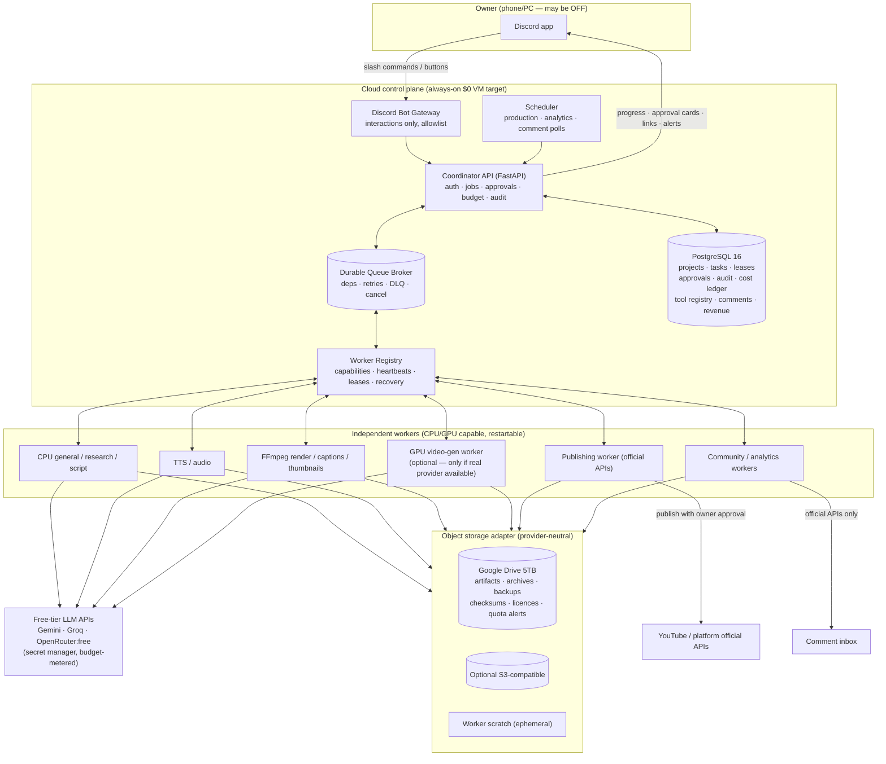

# 01 — System Architecture

**Date:** 2026-11-15 · **Status:** PROPOSED design for approval — no production code exists yet
**Requirements source:** `Universal_AI_Media_Business_OS_Arena_Master_Spec.md` (§2 cloud architecture, §3 Discord, §4 storage, §5 pipeline, §10 agents, §11 security, §12 costs)

---

## 1. Design principles (non-negotiable)

1. **Owner's laptop is optional.** Coordinator, queue, workers, rendering, publishing, comment polling and notifications run in the cloud; the PC may be 100 % off.
2. **Discord is the primary control plane** — phone-first slash commands, approval cards, alerts, emergency stop.
3. **Truthful states** — a job is never "rendering" unless a worker actually holds its lease.
4. **Zero budget by default** — no paid service activates without explicit owner approval and a hard cap.
5. **Storage ≠ compute** — Google Drive holds artifacts/archives; it is never a database, queue, or render engine. GitHub Actions and free notebooks are temporary compute only; never permanent servers or GPU workers.
6. **No capability claims without a tested integration** (no Seedance, no universal text-to-video, no unlimited free GPU).

## 2. Architecture diagram (Mermaid)



## 3. Component responsibilities

| Component | Owns | Explicitly does NOT own |
|---|---|---|
| Discord Bot Gateway | interaction parsing, default-deny allowlist, confirm flows | business logic, secret display |
| Command Router / Auth | RBAC, ephemeral vs public replies, rate limits, emergency pause | task execution |
| Coordinator API | job/task lifecycle, approval gates, budget enforcement, audit events, health | heavy compute |
| Queue Broker | durability, dependency gating, retries/backoff, DLQ, cancellation | scheduling policy |
| Worker Registry | capability matching, leases, heartbeats, crash recovery | task semantics |
| Scheduler | cron/interval triggers (production, analytics, comment polling) | ad-hoc commands |
| Workers | one typed task type each, declared CPU/RAM/GPU/runtime/budget | cross-task state, shell escape |
| Object storage adapter | upload/download/list/checksum/quota/licence metadata, temp links | live DB files of any kind |
| Free-LLM adapter | provider routing, retry, usage metering against caps | storing prompts containing secrets |
| Tool registry | catalogue, licence/commercial-use fields, integration status, fallbacks | auto-installing anything |

## 4. Control flows

### 4.1 Job creation → completion (while laptop is off)

```
Owner: /video create "..." (phone, Discord)
  → Bot → Coordinator API: validated job + idempotency key → PostgreSQL + Queue
  → Workers claim tasks by lease; heartbeats every ~10 s
  → Progress events → Discord messages / approval cards
  → /video approve (owner taps) → final stage → artifact uploaded via storage adapter
  → Discord message with checksummed link
  → /status and /queue show truth at any time (even mid-flight, even after restart)
```

### 4.2 Approval gates (hard, not advisory)

Publishing, public replies, spending money, deleting files and changing settings **must** pass an owner confirmation card (preview + sources + risk flags). Default reply mode for comments = **draft-only**. No auto-reply for legal/medical/financial/complaints/misinformation/safety/sponsorship categories (spec §6).

### 4.3 Multi-channel model

`channels` (brand, language, niche, style profile, schedules) ← `projects` (tenancy boundary with its own budget) → all jobs/tasks/assets scoped to a channel. Formats: YouTube long-form, Shorts/vertical, Reels-style, documentary, cartoon stories, explainers, motion graphics/data-viz — selected via **visual style profiles** (8 styles), each declaring asset sources and camera/transition conventions.

## 5. Production pipeline (24 steps, resumable, typed)

Every step = a typed task (`input schema → output schema`) with validation, idempotency key, retry policy, checkpoint persistence, audit event and budget metering. Crash → resume at last completed step.

```
1 Request intake → 2 Niche/channel → 3 Topic research → 4 Sources+citations → 5 Fact verification
→ 6 Script → 7 Story structure/hook → 8 Character & visual bible → 9 Storyboard → 10 Scene/shot plan
→ 11 Assets (generate | stock | original graphics) → 12 Voiceover (TTS) → 13 Music/SFX
→ 14 Animation/motion → 15 Scene render → 16 FFmpeg assembly → 17 Captions/subtitles
→ 18 Thumbnail → 19 Technical QC → 20 HUMAN REVIEW (Discord) → 21 Publish prep (licence+metadata check)
→ 22 Owner approval → 23 Publish (official API, idempotent, verified) → 24 Analytics + learning
```

**Asset fallback chain (per style):** free AI generation (only when a real integration exists) → licensed stock (Pexels/Pixabay-class APIs, attribution ledger) → original graphics/motion templates. **Universal text-to-video and 3D scene generation are not claimed** — they remain BLOCKED until a tested integration exists.

## 6. Database design (PostgreSQL)

| Table | Purpose | Key columns |
|---|---|---|
| `projects` | tenancy + budgets | id, name, status, budget_cents, created_at |
| `channels` | brand/niche/language/formats | id, name, language, niche, style_profile, schedules |
| `jobs` | production runs | id, project_id, type, state, idempotency_key UNIQUE, checkpoint, requested_by |
| `tasks` | stage units | id, job_id, type, state, attempt, max_attempts, input/output JSON, not_before, priority |
| `task_dependencies` | DAG edges | pred_task_id, succ_task_id |
| `workers` | registry | id, kind, capabilities JSON, cpu, ram_mb, gpu, host, status |
| `worker_leases` | claim safety | task_id, worker_id, lease_expires_at, heartbeat_at |
| `approvals` | human gates | id, job_id, kind, state, decided_by, decided_at, reason |
| `audit_events` | append-only | id, actor, action, subject, result, at, payload |
| `cost_ledger` | usage & spend | id, project_id, provider, units, cost_cents, at |
| `asset_sources` | copyright | id, asset_uri, source, licence, hash, checked_at |
| `tools` | 100+ registry | name, repo_url, category, licence, commercial_use, hw_reqs, api_reqs, free_tier_limits, fallback, status |
| `comment_inbox` | Phase 5 | id, platform, external_id, text, classification, reply_state |
| `revenue_records` | Phase 7 | id, module, channel/product, amount_cents, kind(actual\|pipeline), at |
| `settings` | system flags | key, value (e.g. `system.paused`) |

Indexes: `(state, not_before)` on tasks · partial unique `jobs.idempotency_key` · `lease_expires_at` · `(project_id, at)` on cost_ledger · append-only enforcement on audit_events (rules/trigger).

**Migration system:** Alembic, forward + tested downgrade. **Backups:** scheduled `pg_dump` → storage adapter (`00-system-backups/`) with periodic restore drills (§8).

## 7. Queue design (decision + semantics)

**Phase 1 choice: PostgreSQL-backed queue** (`SELECT … FOR UPDATE SKIP LOCKED` + `LISTEN/NOTIFY`) behind a `Broker` interface.

| Option | Verdict | Why |
|---|---|---|
| **Postgres SKIP LOCKED (chosen for Phase 1)** | ✅ | zero extra services on a $0 VM; one durability domain with the data; enough for dozens of tasks/min; simplest backup story |
| Redis (RQ/Arq/Celery) | ⏸ later | promote only when measured throughput/concurrency needs it; interface already allows drop-in |
| RabbitMQ | ⏸ later | stronger routing, more ops burden — unjustified at Phase 1 scale |
| Google Drive / synced folder as queue | ❌ forbidden | spec §2.4 — never a live queue/DB |
| In-memory queue only | ❌ | loses jobs on restart |

**Semantics (test-enforced):** atomic claim (two workers can never run the same task) · successor runs only when all predecessors `SUCCEEDED` · exponential backoff + jitter · `attempt ≥ max_attempts` → DLQ, visible via API, manual requeue · cancellation propagates to successors · `system.paused` stops all dispatch instantly (emergency stop foundation).

## 8. Failure recovery & backup strategy

| Failure | Detection | Recovery (tested in Phase 1) |
|---|---|---|
| Worker crash mid-task | lease TTL expiry (no heartbeat) | requeue with `attempt+1`; idempotency keys prevent double-effects |
| Coordinator restart | — | stateless; all truth in PostgreSQL; in-flight leases reaped on boot |
| Queue message loss | impossible-by-design (tasks are rows) | task row remains source of truth |
| Duplicate side effects | idempotency keys on jobs + publish operations | second attempt is a no-op |
| DB corruption/loss | restore drill | `pg_dump` cron → Drive `00-system-backups/` → encrypted → **restore tested every phase** |
| Storage upload interruption | checksum mismatch on verify | resume/retry; content hash recorded in `asset_sources` |
| Budget overrun | ledger vs cap | auto-pause expensive tasks + Discord alert (never silent charges) |
| Provider quota exhausted (free tier) | adapter maps 429/quota errors | cooldown + notify owner; job stays queued, truthfully labeled |
| Emergency | `/system pause` (Phase 2) | dispatch halted globally; resumable |

## 9. Security architecture

- Default-deny Discord allowlist (user + guild + channel IDs) at the router; unknown users rejected; secrets never in messages.
- Bearer/internal auth Phase 1 → full RBAC Phase 2; input validation on every endpoint.
- Secrets: host secret manager only (`.env.example` in git, real `.env` git-ignored); OAuth tokens (Google) encrypted at rest.
- Least-privilege platform scopes; separate dev/prod environments; dependency + container scanning in CI.
- Every external action → `audit_events` row. Rate limits per user and per provider.
- Emergency stop global flag. Data export/deletion endpoints (Phase 6+). Retention policies for temp renders — originals never auto-deleted.

## 10. Business modules (5 revenue streams — separate, actuals only)

A Own-channel monetization · B Client video services + CRM · C Digital products/templates · D Affiliates · E Sponsorships (+ future automation). Each module records **actual** revenue/expenses in the ledger; pipeline opportunities shown separately; no fabricated projections (spec §8).

## 11. Tool registry architecture (100+ over time)

Registry row per tool: name · official repo · category · description · install steps · OS compat · hardware · licence · commercial-use flag · API requirements · free-tier limits · fallback · integration status (`discovered → evaluated → approved → integrated → deprecated`).
**No bulk downloads; no auto-execution of third-party code; owner approval before any install;** isolated evaluation + secret scan + tests recorded per entry (spec §9).

## 12. Deployment topology (zero-budget target)

```
Owner phone ──Discord──▶ [Cloud VM: bot + coordinator + Postgres + queue + CPU worker(s)]
                              │
                              ├─▶ storage adapter ─▶ Google Drive 5TB (artifacts/archives/backups)
                              │                     (+ optional S3-compatible for hot artifacts)
                              ├─▶ free LLM APIs (metered, capped, secret-managed)
                              ├─▶ GitHub Actions ── CI + temporary batch jobs ONLY
                              └─▶ Kaggle/Colab free GPU ── manual experiments ONLY
                                   (never in the production critical path)
```

All services containerized behind a deployment abstraction so the hosting provider can be swapped without touching application code. **Google Drive does no computing. GitHub Actions is not a server. No free GPU is promised.**

## 13. Explicitly out of scope of this document

Phase 1 implementation (awaits approval · file-level plan in `05-PHASE-1-IMPLEMENTATION-PLAN.md`) · Discord bot code (Phase 2) · any video pipeline code (Phase 3) · any paid provider activation (owner approval + cap required).
