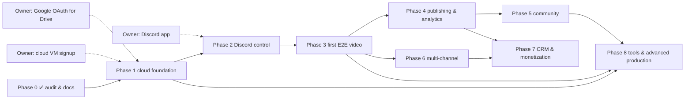

# 03 — Development Roadmap

**Date:** 2026-11-15 · **Status:** PLANNED — Phase 1 begins only after explicit owner approval
**Method (every phase):** explain → inspect → modify → run tests → fix failures → update docs → show changed files → report completed/remaining (spec §15).

**Priority:** P0 = unblocks everything · P1 = first real video · P2 = run the business · P3 = scale.

---

## Phase 0 — Audit & safety ✅ COMPLETE (this deliverable set)

Six documents under `docs/`: audit · architecture (Mermaid) · gap report · roadmap · cloud/hardware compatibility · Phase 1 plan. No production deployment.

**Exit criteria:** owner reviews and explicitly approves Phase 1. — *pending*

---

## Phase 1 — Cloud foundation (P0) — ESTIMATE & DEPENDENCIES

| Attribute | Value |
|---|---|
| Scope | repo scaffolding · PostgreSQL schema + Alembic · durable queue (deps/retry/DLQ/cancel) · coordinator API · worker registry (register/claim/lease/heartbeat/recovery) · storage interface + local FS (+ Google Drive adapter once OAuth exists) · budget ledger + caps · tool registry schema + ~10 verified entries · pytest incl. real-Postgres integration · CI workflow · deploy scripts + backup/restore drill |
| Exact file list & acceptance tests | `05-PHASE-1-IMPLEMENTATION-PLAN.md` |
| Dependencies | Python 3.11+ · fastapi · sqlalchemy≥2 · alembic · pydantic-settings · psycopg[binary] · httpx · pytest/ruff (dev) · pgserver (dev, optional embedded PG) · PostgreSQL 16 on target VM · (owner) cloud VM signup · (owner) Google OAuth client for Drive adapter |
| Complexity | **Medium** — ~35–45 files, no heavy deps; risk concentrated in queue semantics + lease recovery (both test-enforced) |
| Blocks | Phases 2, 3 (everything runs on this foundation) |
| Cost | $0 |

**DoD:** all tests green · scripted hello-job runs coordinator↔worker↔storage on the cloud VM with laptop off · recovery test passes · restore drill passes · rollback = revert merge + `alembic downgrade`.

## Phase 2 — Discord control plane (P0/P1) — ESTIMATE & DEPENDENCIES

| Attribute | Value |
|---|---|
| Scope | bot registration instructions · default-deny allowlist · core slash commands (`/help /status /system health /projects* /channels* /video create|status|cancel|approve|reject|preview /queue* /worker status /tools* /budget* /costs report /storage* /system pause|resume`) · buttons/menus · approval cards with preview+links · progress messages · alerts (worker failure, budget, storage) · emergency stop wiring |
| Dependencies | Phase 1 API complete · owner creates Discord application (action B4) · discord library |
| Complexity | **Low–Medium** — ~15–25 files; most risk is permission/UX, not infra |
| Blocks | Phase 3 (approval gate UX), acceptance test D |
| Cost | $0 |

## Phase 3 — One end-to-end video (P1) — ESTIMATE & DEPENDENCIES

| Attribute | Value |
|---|---|
| Scope | first vertical slice of the 24-step pipeline for **one 30–60 s original video**: intake → research → script → structure → bible → storyboard → shot plan → assets (stock/graphics fallback) → TTS → assembly (cloud FFmpeg worker) → captions → thumbnail → QC → approval gate → artifact to storage → link to Discord · resource declarations per task · checkpoint/resume |
| Dependencies | Phase 1+2 · **ffmpeg binary on worker** (absent today) · free LLM key (Gemini/Groq) via secret manager · stock API keys (free) · TTS choice with licence audit · Drive adapter live (B2) |
| Complexity | **High** — ~40–60 files across adapters; mitigate by building one format (vertical Short) only |
| Blocks | Phase 4, acceptance tests A/B/H |
| Cost | $0 (free tiers only; metered + capped) |

## Phase 4 — Publishing & analytics (P1)

| Attribute | Value |
|---|---|
| Scope | YouTube adapter with documented capability matrix (OAuth scopes, limits) · draft → preview → licence/metadata check → **owner approval** → idempotent publish → verify · analytics import · Discord reports · other platforms added only as documented adapters (unsupported ops labeled, manual fallback) |
| Dependencies | Phase 3 output quality gates pass · owner's Google OAuth + YouTube channel auth · spec §7 matrices |
| Complexity | **Medium** — API quotas and verification loops dominate |
| Blocks | Phase 5 (comment APIs), monetization data |
| Cost | $0 (YouTube Data API free quota) |

## Phase 5 — Community management (P2)

Comment inbox (official APIs) · language/topic/sentiment/intent classification · praise/question/complaint/spam/misinfo/business categorization · reply **drafts by default** · owner approval to send · restricted auto-reply only for explicitly approved low-risk categories · escalation list (legal/medical/financial/complaint/misinfo/safety/sponsorship never auto-replied) · repeated-question → FAQ proposals · rate-limit respect. | Complexity **Medium** · deps: Phase 4 auth · Cost $0 · acceptance test E.

## Phase 6 — Multi-channel content operations (P2)

Multiple channel configs/brands · separate schedules and analytics · shared production templates · data export/deletion tooling. | Complexity **Low–Medium** (schema exists from Phase 1; work is config + ops UX) · deps: Phases 3–4 stable.

## Phase 7 — CRM & monetization (P2)

Five **separate** business modules: own-channel revenue · client services CRM (leads, proposals, delivery, invoices) · digital products catalog/orders · affiliate tracking · sponsorship pipeline · actual-vs-pipeline revenue reporting, per-channel P&L, monthly cashflow — **actuals only, no fabricated forecasts**. | Complexity **Medium** · deps: Phase 4 analytics + Phase 1 ledger tables · Cost $0.

## Phase 8 — Advanced production & tool ecosystem (P3)

Remaining visual styles · more asset/TTS/video adapters (only real, tested ones) · tool registry toward **100+ verified entries** · optional GPU providers (only if a real, affordable/free one exists) · distributed worker scaling · semantic visual continuity QA · Hermes-style conversational interface. | Complexity **High but incremental** — one verified tool at a time, no bulk imports.

---

## Dependency map

## Cross-phase engineering standards

1. Truthful labels — IMPLEMENTED only with a passing test; unimplemented never described as working.
2. No placeholder buttons, fake agents, doc-only features, or bulk empty files.
3. No paid API/hosting/subscription without explicit owner approval + cap.
4. No reverse engineering to bypass licensing/DRM/payments/API restrictions — legitimate APIs and open-source alternatives only.
5. Feature branch → PR → review; never direct push to `main`.
6. Per-phase report: changed files · commands · test results · security/cost notes · limitations · rollback · next-phase proposal.

## What would change this plan

- **Owner supplies v2.1.0 source** → add a migration/reuse step to Phase 1; some adapters ported instead of built.
- **Free tiers shrink further** → swap VM/LLM providers through the existing abstraction; update `04` snapshot.
- **Owner approves a budget** → optional managed Postgres/queue; still capped and gated.
